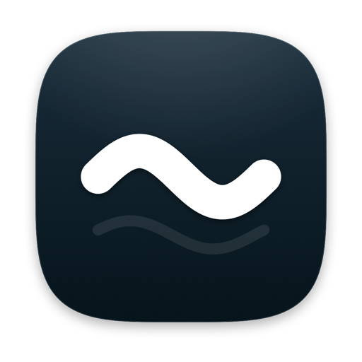
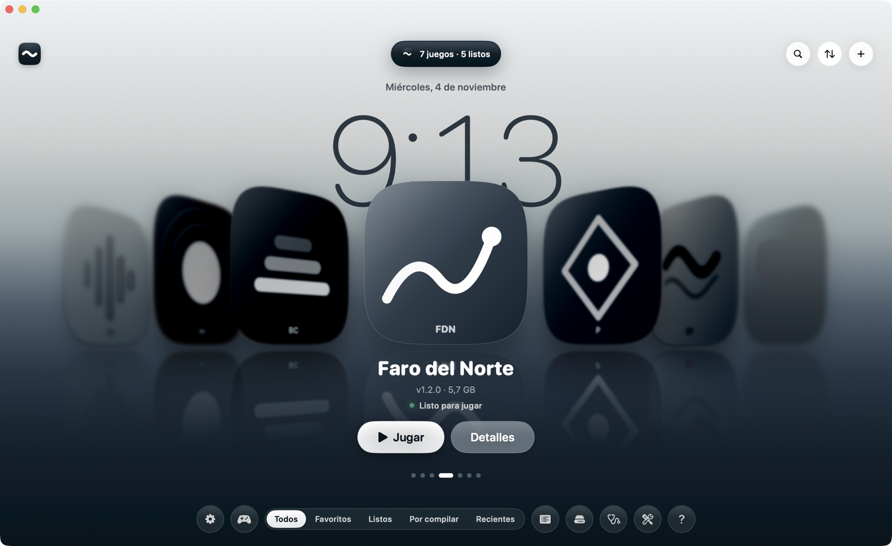
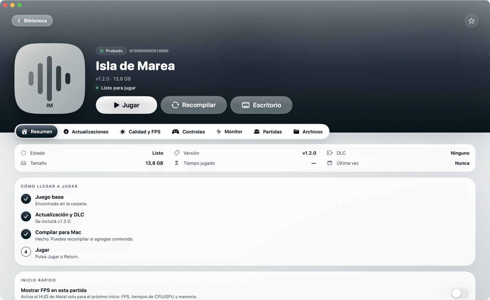
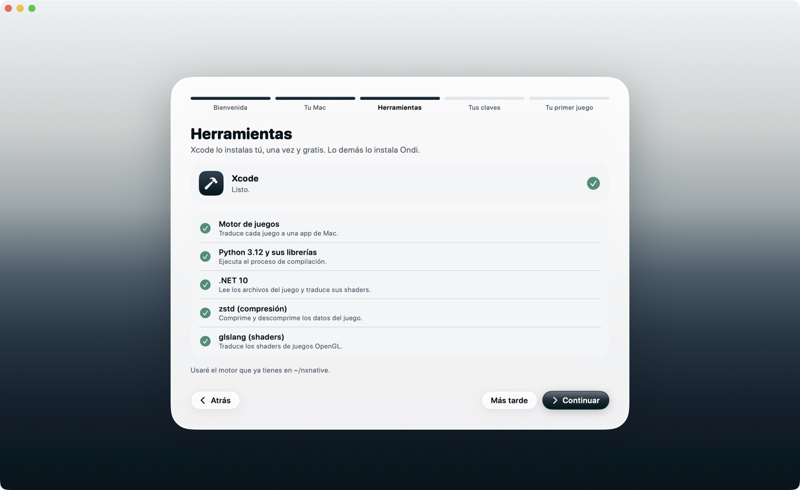
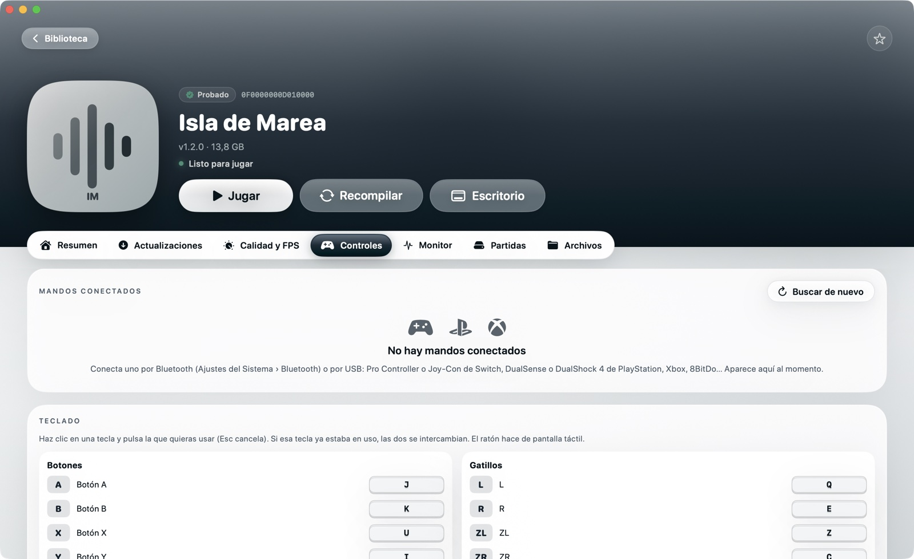
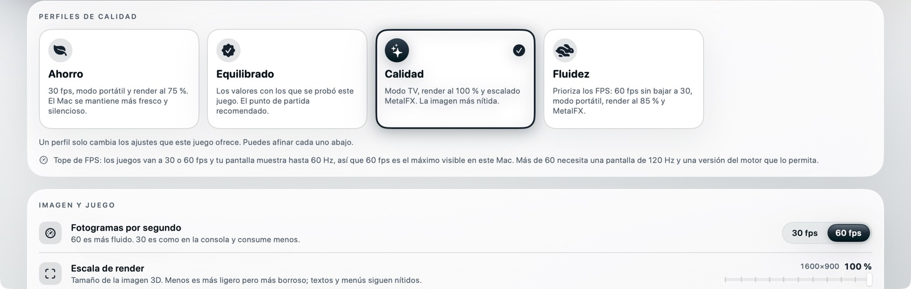
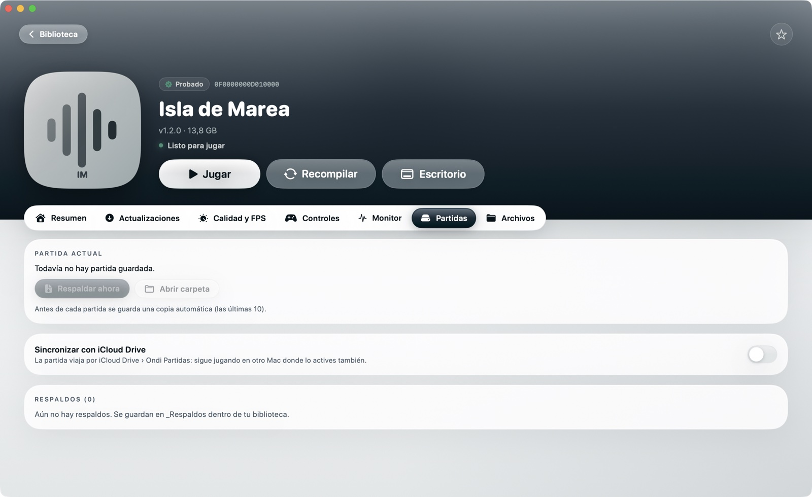
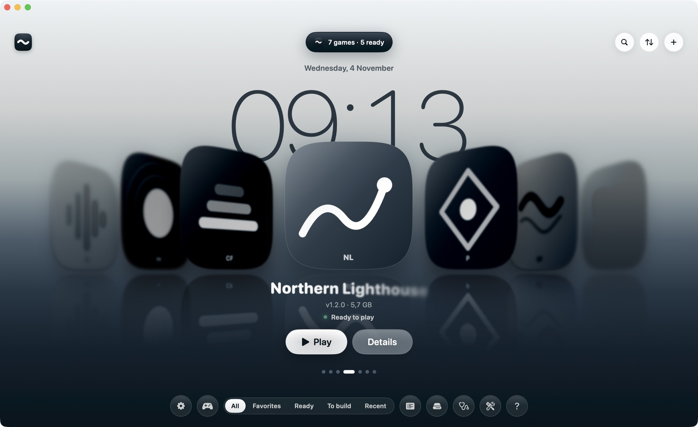

<p align="center">
  
</p>

<h1 align="center">Ondi</h1>

<p align="center"><b>Tus juegos de consola, convertidos en apps de Mac.</b><br>
Pones tus juegos y tus claves; Ondi instala lo que hace falta, los compila y los deja listos para jugar.</p>

<p align="center">
  <a href="docs/GUIA.md">Guía completa</a> ·
  <a href="docs/COMPATIBILIDAD.md">Juegos compatibles</a> ·
  <a href="#english">English</a> ·
  <a href="NOTICE.md">Créditos</a> ·
  <a href="brand/brand-kit.html">Brand kit</a>
</p>

<p align="center"></p>

> [!IMPORTANT]
> **Ondi no incluye, no descarga y no enlaza juegos, claves ni firmware.** Úsalo solo con juegos que extraigas de tu propia consola y con las claves (`prod.keys`) de esa misma consola. Ondi no está afiliado a Nintendo ni a ninguna editorial. Nintendo Switch es una marca de Nintendo.

## Qué es

Ondi es una app de Mac, open source y gratuita, que convierte los juegos que extraes de tu consola en **apps nativas** para Mac con chip Apple. No es un emulador: el código del juego corre directamente sobre el chip y sus gráficos se reconstruyen con Metal. Ese trabajo lo hace un motor open source que Ondi descarga y mantiene por ti ([créditos](NOTICE.md)).

**[129 juegos](docs/COMPATIBILIDAD.md)** tienen hoy un perfil probado.

## Qué trae

| | |
|---|---|
|  | **Una biblioteca que se siente viva.** Las portadas giran sobre un piso de agua con la hora detrás, y cada juego tiene su ficha con estado, versiones, calidad, controles, partidas y archivos. |
|  | **Listo en minutos.** Un asistente revisa tu Mac, te ayuda con Xcode e instala por su cuenta todo lo demás. |
|  | **Cualquier mando.** Switch, PlayStation, Xbox, 8BitDo… con prueba botón por botón, teclas del teclado a tu gusto y modo sofá para manejar la biblioteca con el mando. |
|  | **Calidad a tu medida.** Perfiles Ahorro, Equilibrado, Calidad y Fluidez, o cada ajuste a mano. |
|  | **Tus partidas a salvo.** Respaldo automático antes de cada sesión, restaurar con un clic y sincronización por iCloud Drive. |

Además: lista de compatibilidad con buscador, cola de compilación con notificaciones, gestión de espacio (borrar cachés, mover la biblioteca a otro disco), juegos en el Escritorio y la interfaz en español e inglés.

## Qué necesitas

- Un Mac con chip Apple (M1 o más nuevo) y **macOS 26.6** o más nuevo.
- **Xcode**, gratis en la App Store. Es lo único que instalas tú: trae el compilador de gráficos de Apple, que no se puede redistribuir.
- Tus juegos (NSP o XCI, con su actualización si la tienes) y tu `prod.keys`.
- Espacio: unas dos veces el tamaño de cada juego más 10 GB mientras se compila.

## Instalar

1. Descarga `Ondi.zip` de la [última versión](../../releases/latest), descomprímelo y arrastra **Ondi** a Aplicaciones.
2. Ábrelo. Como Ondi no está firmado con una cuenta de desarrollador de Apple, macOS lo bloquea la primera vez: ve a **Ajustes del Sistema › Privacidad y seguridad** y pulsa **Abrir igualmente** en el aviso sobre Ondi. Solo hace falta una vez.
   *(O en la Terminal: `xattr -dr com.apple.quarantine /Applications/Ondi.app`)*

**Desde el código**, con Xcode instalado:

```sh
git clone https://github.com/vizzeuk/ondi.git && cd ondi
./scripts/make_app.sh --install      # compila Ondi.app y la copia a Aplicaciones
```

Después, el asistente de primer uso te guía: tu Mac, las herramientas, tus claves y tu primer juego. Todo está explicado en la **[guía](docs/GUIA.md)**.

## Preguntas frecuentes

**¿Dónde guarda todo?** La app en Aplicaciones; el motor, las herramientas y tus claves en `~/Library/Application Support/Ondi`; tus juegos en la carpeta de biblioteca que elijas (por defecto `~/Games`).

**¿Envía algo a internet?** No. Solo descarga el motor y las herramientas desde sus fuentes oficiales. No hay telemetría.

**¿Funciona cualquier juego?** Los que tienen un [perfil probado](docs/COMPATIBILIDAD.md) funcionan de forma fiable. Los demás pueden funcionar o no.

**¿Cómo lo desinstalo?** Borra Ondi de Aplicaciones y la carpeta `~/Library/Application Support/Ondi`. Tus juegos y partidas quedan donde estaban.

## Contribuir

Las ideas, los errores y el código son bienvenidos. **Cualquier issue o pull request que pida, enlace o explique cómo conseguir juegos, claves o firmware se cierra sin respuesta.**

Ondi está hecho en SwiftUI (macOS 14+) con Swift Package Manager:

```sh
swift build                       # compilar
./scripts/make_app.sh             # crear build/Ondi.app
NXB_DEMO=1 build/Ondi.app/Contents/MacOS/NXBiblioteca   # abrirla con una biblioteca de ejemplo
```

**Traducciones.** El español es el idioma base. Cada idioma es un archivo en `Localization/` (por ejemplo `en.json`):

```sh
scripts/l10n.py extract    # lista todos los textos de la app en Localization/keys.json
scripts/l10n.py check      # qué falta traducir en cada idioma
scripts/l10n.py build      # genera los archivos que usa la app
```

Para agregar un idioma, copia `Localization/en.json` como `Localization/<código>.json`, traduce los valores y ejecuta `build`.

**Otros scripts:** `scripts/make_compat.py` regenera la lista de juegos compatibles desde el motor; `scripts/make_brand.swift` y `scripts/make_icon.swift` dibujan el logo y el ícono desde la misma geometría que usa la app.

## Licencia

[MIT](LICENSE). El motor y las herramientas que Ondi descarga conservan sus propias licencias: ver [NOTICE.md](NOTICE.md).

---

<a name="english"></a>
## English

<p align="center"></p>

**Ondi turns the games you dump from your own console into native apps for Apple silicon Macs.** Drop in your games and your `prod.keys`; a setup assistant checks your Mac, helps with Xcode (free on the App Store) and installs everything else by itself. Then build each game and play. It's a free, open-source front end for an MIT-licensed engine ([credits](NOTICE.md)); [129 games](docs/COMPATIBILIDAD.md) have a tested profile.

**Ondi does not include, download or link to games, keys or firmware.** Use it only with games and keys from a console you own. Not affiliated with Nintendo.

- **Requirements:** Apple silicon, macOS 26.6+, Xcode.
- **Install:** download `Ondi.zip` from [Releases](../../releases/latest). The app isn't notarized, so the first time go to System Settings › Privacy & Security › **Open Anyway**. Or build it with `./scripts/make_app.sh --install`.
- **Features:** carousel library, setup assistant, any controller with a live button test, remappable keyboard, couch mode, quality presets, build queue with notifications, automatic save backups and iCloud Drive sync, disk space tools.
- **Language:** the interface follows your Mac's language (Spanish or English). Translations live in `Localization/` and are easy to add.
- **Guide:** [docs/GUIA.md](docs/GUIA.md) (Spanish).
