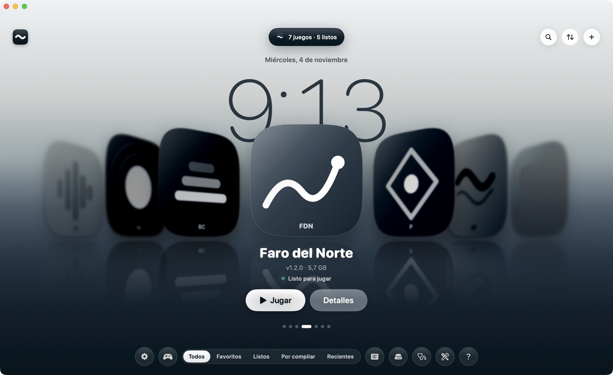
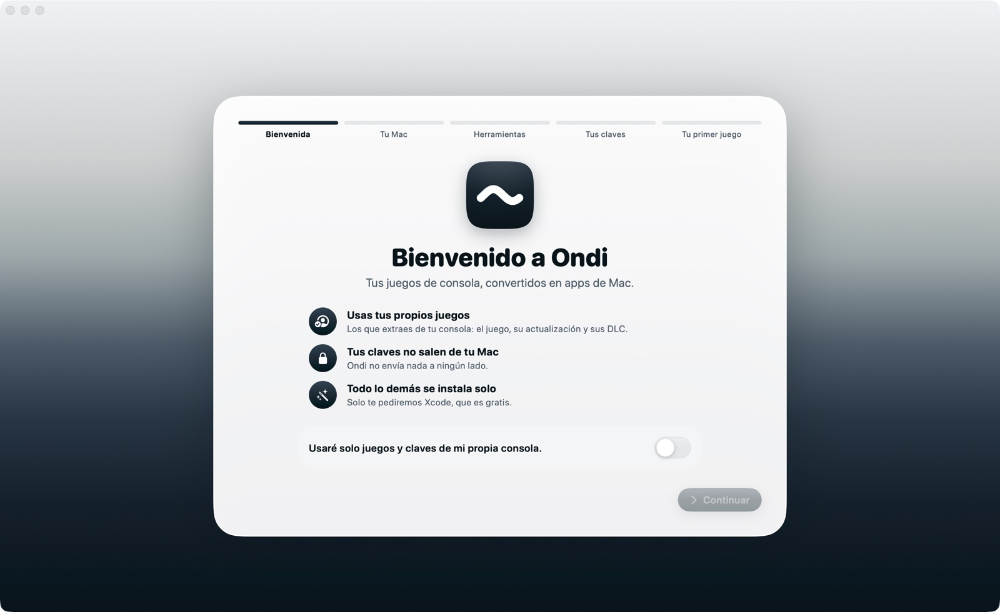
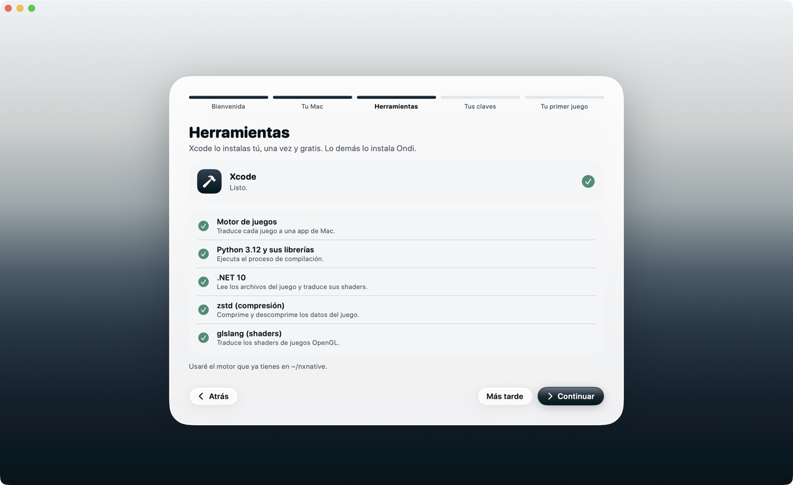
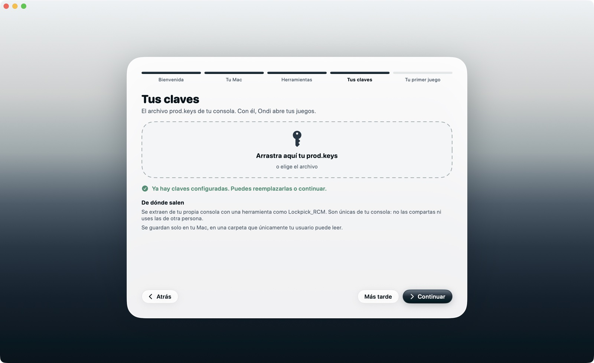
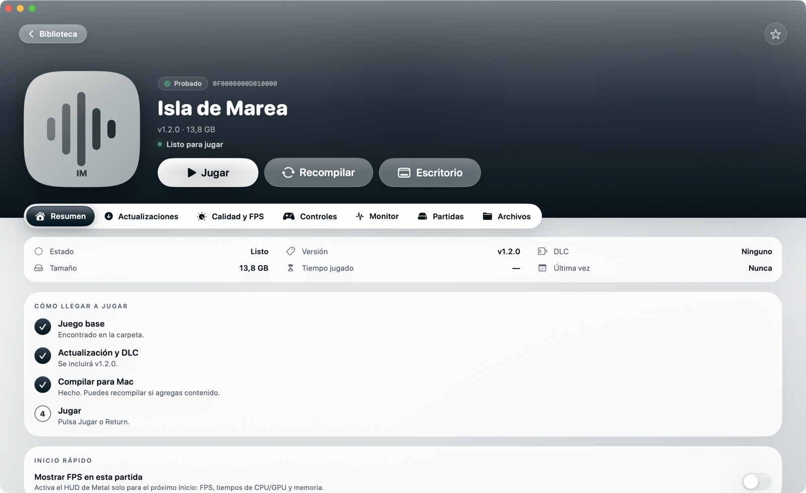
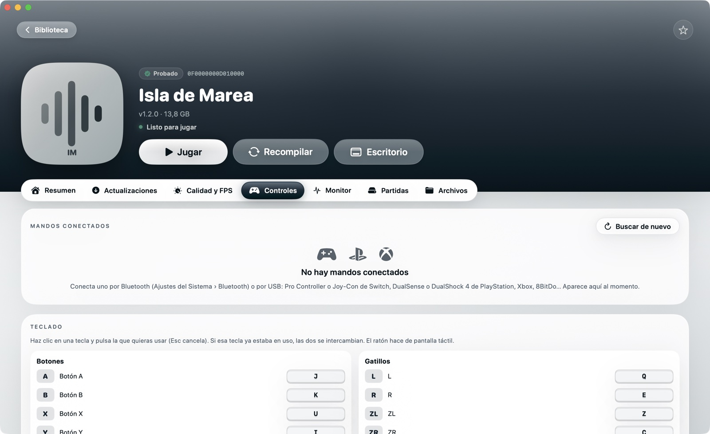
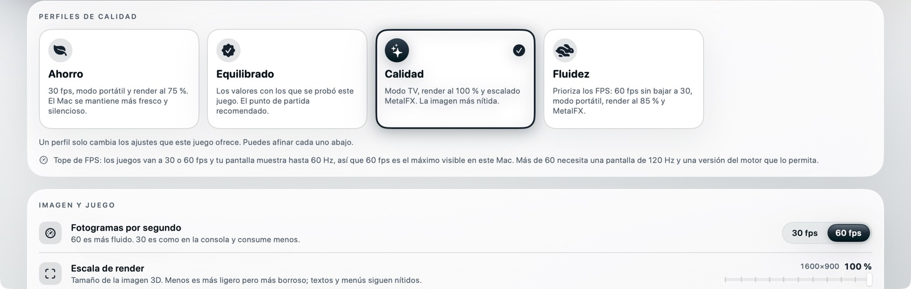
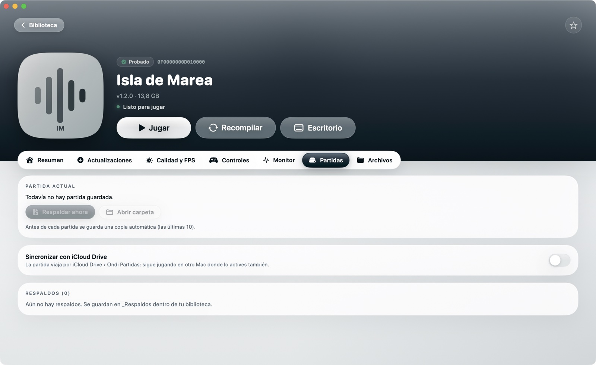
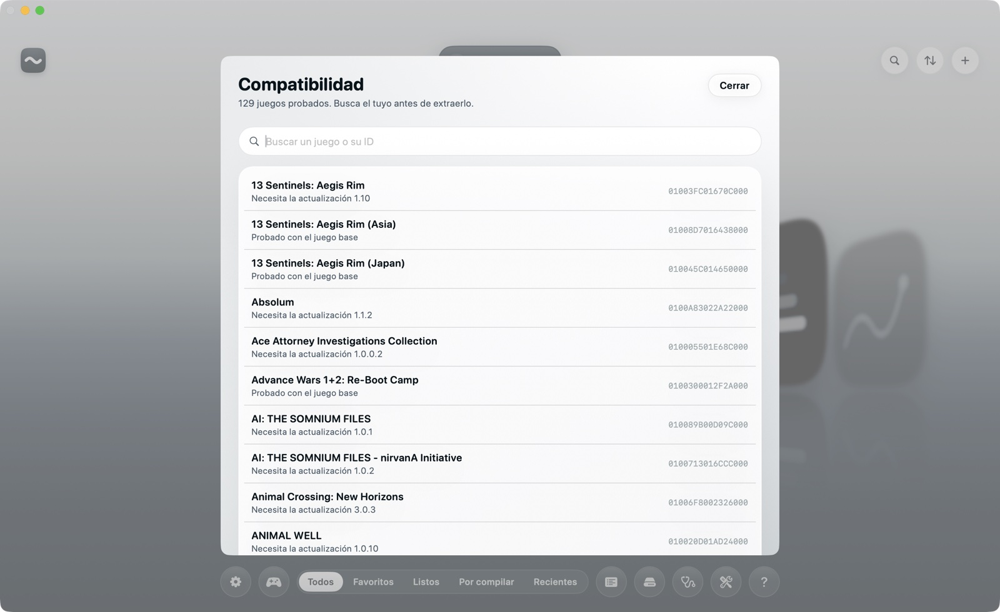
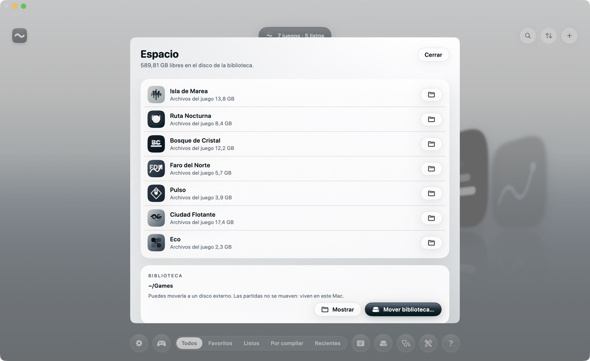

# Guía de Ondi

Todo lo que hace Ondi, paso a paso. Si es tu primera vez, lee **Instalar** y **La primera vez**; el resto puedes consultarlo cuando lo necesites.

> [!IMPORTANT]
> Ondi no incluye, no descarga y no enlaza juegos, claves ni firmware. Usa solo juegos que extraigas de tu propia consola y las claves de esa misma consola.

**Contenido:** [Qué es](#qué-es) · [Qué necesitas](#qué-necesitas) · [Instalar](#instalar) · [La primera vez](#la-primera-vez) · [La biblioteca](#la-biblioteca) · [Agregar juegos](#agregar-juegos) · [Compilar](#compilar) · [La ficha de un juego](#la-ficha-de-un-juego) · [Jugar: teclado y mandos](#jugar-teclado-y-mandos) · [Calidad y FPS](#calidad-y-fps) · [Partidas](#partidas) · [Compatibilidad](#compatibilidad) · [Espacio](#espacio) · [Escritorio y Aplicaciones](#escritorio-y-aplicaciones) · [Idiomas](#idiomas) · [Si algo falla](#si-algo-falla) · [Desinstalar](#desinstalar)

---

## Qué es

Ondi convierte cada juego que extraes de tu consola en una **app de Mac**: un ícono más en tu Mac que abre el juego en una ventana o en pantalla completa. No es un emulador. El código del juego corre directamente sobre el chip de Apple y sus gráficos se reconstruyen con Metal, por eso va fluido.

El trabajo de traducir cada juego lo hace un **motor** open source. Ondi lo descarga, lo mantiene y le pone una interfaz para que todo sea arrastrar, compilar y jugar.

## Qué necesitas

| | |
|---|---|
| **Mac** | Con chip Apple (M1 o más nuevo) y macOS 26.6 o más nuevo |
| **Xcode** | Gratis en la App Store. Trae el compilador de gráficos de Apple, que no se puede redistribuir |
| **Tus juegos** | El juego base en NSP o XCI y, si la tienes, su actualización (también sus DLC) |
| **Tus claves** | El archivo `prod.keys` de tu consola |
| **Espacio** | Unas dos veces el tamaño de cada juego más 10 GB mientras se compila |

Los juegos y las claves se extraen de tu consola con herramientas como **nxdumptool** o **DBI** (juegos) y **Lockpick_RCM** (claves). Las claves son únicas de tu consola: no las compartas ni uses las de otra persona.

## Instalar

1. Descarga `Ondi.zip` de la [página de versiones](../../../releases) y descomprímelo.
2. Arrastra **Ondi** a Aplicaciones.
3. Ábrelo. Como Ondi no está firmado con una cuenta de desarrollador de Apple, macOS lo bloquea la primera vez. Ve a **Ajustes del Sistema › Privacidad y seguridad**, baja hasta el aviso sobre Ondi y pulsa **Abrir igualmente**. Solo hace falta una vez.

Si prefieres la Terminal, esto quita el bloqueo: `xattr -dr com.apple.quarantine /Applications/Ondi.app`

**Desde el código:** con Xcode instalado, `git clone` este repositorio y ejecuta `./scripts/make_app.sh --install`. Una app compilada en tu Mac no tiene el bloqueo.

## La primera vez

Un asistente te acompaña en cinco pasos.

| | |
|---|---|
|  | **1. Bienvenida.** Confirmas que usarás tus propios juegos y claves. |
|  | **2. Tu Mac** revisa el chip, macOS, el espacio y la memoria. **3. Herramientas:** Ondi te ayuda con Xcode (abrir la App Store, activarlo y aceptar su licencia, descargar el componente Metal) y descarga lo demás por su cuenta: el motor, Python, .NET, zstd y glslang. Son unos 1,3 GB y van todos en `~/Library/Application Support/Ondi`; nada se instala en el sistema. |
|  | **4. Tus claves.** Arrastras tu `prod.keys`; Ondi comprueba que tenga lo necesario y lo guarda en una carpeta que solo tu usuario puede leer. **5. Tu primer juego.** Lo arrastras y ves si tiene un perfil probado. |

Puedes volver a abrir el asistente cuando quieras desde **Ajustes › Instalación › Asistente de primer uso**.

## La biblioteca

Tus juegos aparecen como portadas cuadradas que giran sobre un piso de agua. La del centro es el juego elegido; debajo se lee su estado y lo que puedes hacer con él.

- **Moverte:** arrastra las portadas, desliza con dos dedos en el trackpad, usa ← → o haz clic en una portada.
- **Jugar o compilar:** el botón principal cambia según el juego (Jugar, Compilar para Mac, Agregar archivos…). Return hace lo mismo.
- **Detalles:** abre la ficha del juego.
- **La isla** (arriba al centro) cuenta lo que pasa: cuántos juegos tienes, qué se está compilando y a qué porcentaje, o qué juego está abierto con su uso de CPU y GPU. Si haces clic mientras compila, ves el registro.
- **Abajo:** Ajustes, Controles, los filtros (Todos, Favoritos, Listos, Por compilar, Recientes), Compatibilidad, Espacio, Estado del sistema, Centro de problemas y Guía rápida.
- **Arriba a la derecha:** buscar, ordenar (por nombre, jugados hace poco, más jugados o tamaño) y agregar juegos.
- **Clic secundario en una portada:** jugar, ver detalles, favorito, compilar o recompilar, poner en el Escritorio, mostrar en Finder.

## Agregar juegos

Arrastra los archivos (NSP, XCI, NSZ o XCZ) a la ventana, o pulsa **+**. Ondi reconoce qué es cada archivo (juego base, actualización o DLC) y lo coloca en la carpeta de su juego dentro de la biblioteca (por defecto `~/Games`).

Si un juego necesita una actualización concreta para funcionar bien, la ficha te lo avisa. Agrégala desde la pestaña **Actualizaciones** del juego.

## Compilar

**Compilar para Mac** convierte el juego en una app. La primera vez tarda entre 30 y 60 minutos, porque traduce miles de shaders; las siguientes veces solo rehace lo que cambió.

- Mientras compila puedes seguir usando el Mac. La isla y la ficha muestran la etapa y el progreso.
- **Cola:** si pulsas Compilar en otro juego mientras uno compila, queda **en la cola** y empieza solo cuando termine el anterior. Puedes quitarlo de la cola desde su ficha o con clic secundario.
- **Notificación:** al terminar (o si falla) recibes un aviso de macOS, aunque Ondi esté en segundo plano.
- **Cancelar y retomar:** si cancelas o cierras la app a mitad, lo que ya terminó se conserva. Al volver a compilar, sigue desde la etapa donde quedó.

## La ficha de un juego

Arriba, la portada sobre su propio color, el estado y los botones **Jugar**, **Recompilar** y **Escritorio**. Debajo, las pestañas:

| Pestaña | Para qué |
|---|---|
| **Resumen** | Datos del juego, problemas detectados con su solución, los pasos para llegar a jugar y "mostrar FPS en esta partida" |
| **Actualizaciones** | Qué actualizaciones y DLC tienes, cuál es la probada y cuál se va a compilar |
| **Calidad y FPS** | Perfiles listos y cada ajuste del juego (ver abajo) |
| **Controles** | Mandos conectados, prueba de botones y teclas del teclado |
| **Monitor** | CPU, GPU, memoria y temperatura mientras juegas |
| **Partidas** | Respaldos, restaurar e iCloud Drive |
| **Archivos** | Los archivos del juego, la caché de compilación y los registros |

## Jugar: teclado y mandos

**Mandos.** Funciona cualquier mando que macOS reconozca: Pro Controller y Joy-Con de Switch, DualSense y DualShock 4 de PlayStation, Xbox, 8BitDo y otros. En **Controles** ves cada mando conectado, su batería, si tiene giroscopio y vibración, y una **prueba en vivo**: los botones se iluminan al pulsarlos y, cuando pruebas los 16 botones y los dos sticks, el mando queda **Verificado**. Los botones de los mandos que no son de Nintendo van por posición, como en la consola: el de la derecha es A, el de abajo B, el de arriba X y el de la izquierda Y.

**Teclado.** Estas son las teclas de fábrica, y todas se pueden cambiar en **Controles › Teclado** (haz clic en una tecla y pulsa la nueva):

| Consola | Tecla | Consola | Tecla |
|---|---|---|---|
| A / B / X / Y | J / K / U / I | L / R / ZL / ZR | Q / E / Z / C |
| + / − | Return / Tab | Pulsar sticks (L3 / R3) | F / G |
| Stick izquierdo | W A S D | Cruceta | Flechas |
| Stick derecho (cámara) | Shift + flechas | Agitar el mando | Espacio |

El ratón hace de pantalla táctil.

**Jugadores.** Cada mando es un jugador, en orden de conexión, y el teclado juega con el jugador 1. En Controles puedes hacer que el teclado sea el jugador 1 por su cuenta o que todos los mandos controlen al jugador 1.

**Modo sofá.** La biblioteca también se maneja con un mando: ← → para elegir, **A** para jugar (o compilar), **X** para ver detalles, **B** para volver y **L / R** para cambiar de filtro. Pon la ventana en pantalla completa con ⌃⌘F.

## Calidad y FPS

Cuatro perfiles listos:

- **Ahorro:** 30 fps, modo portátil y render al 75 %. El Mac va más fresco y silencioso.
- **Equilibrado:** los valores con los que se probó el juego. El punto de partida recomendado.
- **Calidad:** modo TV, render al 100 % y escalado MetalFX. La imagen más nítida.
- **Fluidez:** prioriza los FPS, sin bajar a 30.

Debajo puedes cambiar cada ajuste: FPS, escala de render, modo de consola, escalado, idioma del juego, pantalla completa, vibración y opciones avanzadas de rendimiento. Los juegos van a 30 o 60 fps; para ver más de 60 hace falta una pantalla de 120 Hz.

## Partidas

- **Respaldo automático:** antes de cada partida, Ondi copia tu partida. Guarda las últimas 10.
- **Respaldar ahora** y **Restaurar**. Al restaurar, la partida actual se respalda primero, así que no se pierde nada.
- **iCloud Drive:** activa la sincronización y la partida viaja por iCloud Drive › Ondi Partidas, para seguir en otro Mac.

Los respaldos se guardan en la carpeta `_Respaldos` de tu biblioteca.

## Compatibilidad

El botón **Compatibilidad** del inicio muestra los juegos con un perfil probado, con buscador, la actualización que necesita cada uno y una marca si ya está en tu biblioteca. La misma lista está en **[COMPATIBILIDAD.md](COMPATIBILIDAD.md)**. Un juego sin perfil puede funcionar, pero no está probado.

## Espacio

Cuánto ocupa cada juego y su caché de compilación. Puedes **borrar la caché** de un juego (se recrea si lo recompilas) y **mover toda la biblioteca** a otro disco, por ejemplo uno externo. Las partidas no se mueven: viven en tu Mac.

## Escritorio y Aplicaciones

- **Un juego en el Escritorio:** clic secundario en su portada › **Poner en el Escritorio**, o el botón **Escritorio** de su ficha. Se abre como cualquier app.
- **Ondi en Aplicaciones y en el Escritorio:** en **Ajustes › Instalación**.

## Idiomas

Ondi está en **español** e **inglés** y usa el idioma de tu Mac. Para cambiarlo solo en Ondi: **Ajustes del Sistema › General › Idioma y región › Aplicaciones**. ¿Quieres traducirlo a otro idioma? Mira [Contribuir](../README.md#contribuir).

## Si algo falla

- **Centro de problemas** (el ícono de la llave inglesa abajo): todo lo que impide compilar o jugar, explicado, con el botón para resolverlo.
- **Estado del sistema** (el estetoscopio): revisa macOS, Xcode, Metal, el motor, Python y las herramientas, una por una.
- **Ver registro:** durante una compilación, la isla o la ficha muestran el registro completo. Las líneas en rojo dicen qué falló.

Problemas frecuentes:

| Lo que ves | Qué hacer |
|---|---|
| "Falta la actualización probada" | Agrega esa actualización desde la pestaña Actualizaciones y recompila |
| "Falló: falta el compilador de Metal" | Asistente › Herramientas › Descargar Metal (o en Xcode › Ajustes › Componentes) |
| "Falló: problema con las prod.keys" | Tus claves son más antiguas que el juego: actualiza la consola y vuelve a sacarlas |
| "Una compilación anterior sigue activa" | Pulsa **Detener la compilación anterior** y vuelve a compilar |
| El juego se cierra al abrirlo | Vuelve al perfil **Equilibrado** y pruébalo de nuevo; si sigue, revisa el registro del juego |

## Desinstalar

1. Borra **Ondi** de Aplicaciones.
2. Borra la carpeta `~/Library/Application Support/Ondi` (el motor, las herramientas y tus claves).

Tus juegos (en tu biblioteca) y tus partidas quedan donde estaban.
