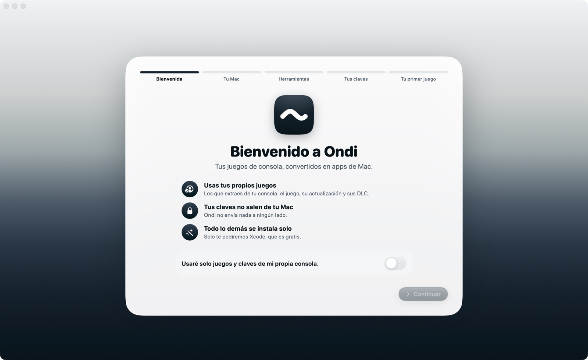
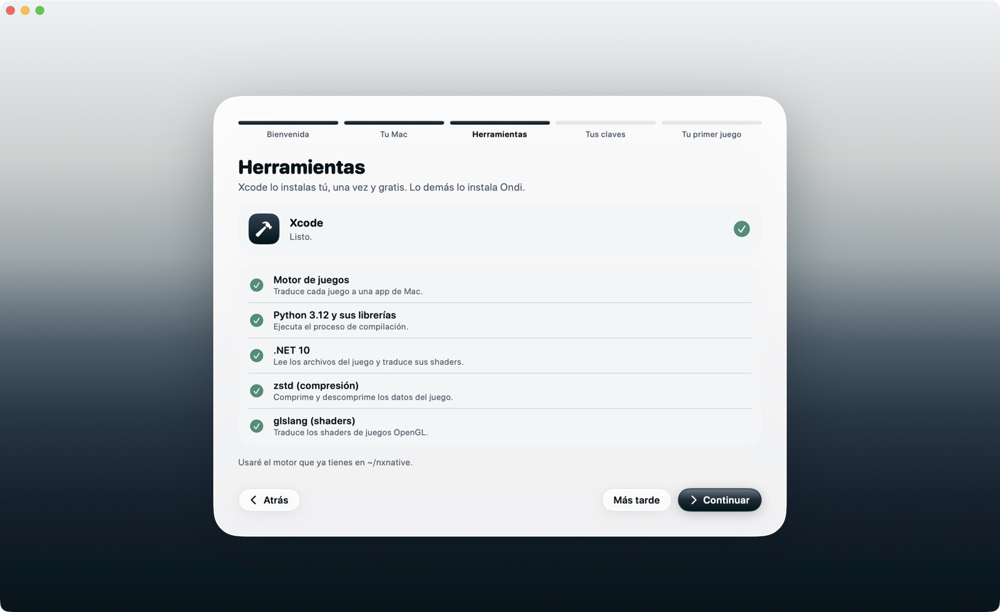
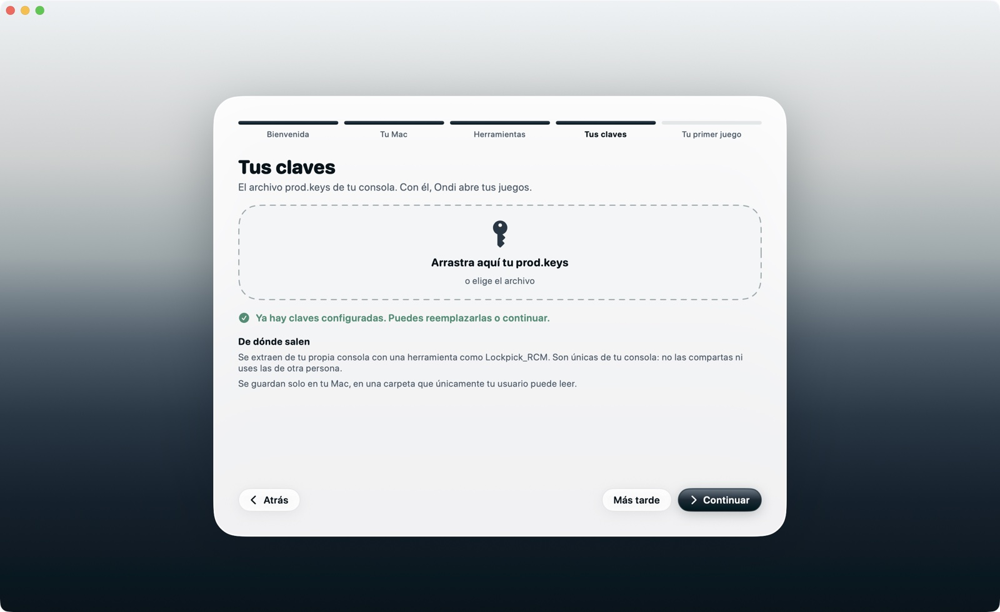

# Guía de instalación

De cero a tu primer juego, paso a paso. Calcula unos 20 minutos más la primera compilación (30 a 60 minutos, mientras puedes seguir usando el Mac).

> [!IMPORTANT]
> Ondi no incluye, no descarga y no enlaza juegos, claves ni firmware. Necesitas tus propios juegos y las claves de tu propia consola.

**Pasos:** [1. Revisa tu Mac](#1-revisa-tu-mac) · [2. Instala Xcode](#2-instala-xcode) · [3. Descarga Ondi](#3-descarga-ondi) · [4. Ábrelo por primera vez](#4-ábrelo-por-primera-vez) · [5. El asistente](#5-el-asistente) · [6. Tu primer juego](#6-tu-primer-juego) · [Instalar desde el código](#instalar-desde-el-código) · [Actualizar](#actualizar) · [Si algo sale mal](#si-algo-sale-mal)

---

## 1. Revisa tu Mac

Menú  › **Acerca de este Mac**:

- **Chip:** Apple M1 o más nuevo (M1, M2, M3, M4, M5…). Los Mac con procesador Intel no sirven: los juegos corren directamente sobre el chip de Apple.
- **macOS:** 26.6 o más nuevo. Si tienes uno anterior: Ajustes del Sistema › General › Actualización de software.
- **Espacio libre:** Ajustes del Sistema › General › Almacenamiento. Para empezar conviene tener al menos 40 GB libres; cada juego necesita unas dos veces su tamaño más 10 GB mientras se compila.

## 2. Instala Xcode

Xcode es la herramienta de Apple para crear apps. Ondi la necesita porque trae el compilador de gráficos de Apple (Metal), que no se puede incluir en otras apps.

1. Abre la [App Store](macappstore://apps.apple.com/app/xcode/id497799835), busca **Xcode** y pulsa **Obtener**. Es gratis y pesa varios GB, así que puede tardar.
2. Ábrelo una vez cuando termine y acepta lo que te pida. Si ofrece descargar componentes, deja marcado **macOS** (y Metal si aparece).

No tienes que aprender a usarlo: Ondi lo usa por su cuenta. El asistente del paso 5 termina de configurarlo.

## 3. Descarga Ondi

1. Entra a la [última versión](../../../releases/latest) y descarga **Ondi.zip**.
2. Haz doble clic en el archivo para descomprimirlo.
3. Arrastra **Ondi** a la carpeta **Aplicaciones**.

## 4. Ábrelo por primera vez

Ondi es gratis y open source, y no está firmado con una cuenta de desarrollador de Apple (cuesta 99 USD al año). Por eso, la primera vez macOS lo bloquea con un aviso. Es normal y solo pasa una vez:

1. Abre Ondi desde Aplicaciones. Aparece un aviso de que macOS no pudo verificarlo: pulsa **Listo**.
2. Ve a **Ajustes del Sistema › Privacidad y seguridad** y baja hasta la sección **Seguridad**.
3. Junto al mensaje sobre Ondi, pulsa **Abrir igualmente** y confirma con tu contraseña o Touch ID.

Desde entonces se abre normalmente.

**Con la Terminal** (equivale a lo anterior): `xattr -dr com.apple.quarantine /Applications/Ondi.app`

## 5. El asistente

La primera vez que se abre, Ondi te guía en cinco pasos:

| | |
|---|---|
|  | **Bienvenida.** Activa "Usaré solo juegos y claves de mi propia consola" y continúa. **Tu Mac.** Revisa el chip, macOS, el espacio y la memoria. |
|  | **Herramientas.** Primero Xcode: según lo que falte verás **Abrir App Store**, **Configurar** (activa Xcode y acepta su licencia; te pide la contraseña) o **Descargar Metal**. Después pulsa **Instalar todo**: Ondi descarga el motor, Python, .NET, zstd y glslang (unos 1,3 GB, en `~/Library/Application Support/Ondi`). Tarda unos minutos según tu conexión. |
|  | **Tus claves.** Arrastra tu `prod.keys` al recuadro. Ondi comprueba que tenga lo necesario y lo guarda en una carpeta que solo tu usuario puede leer. **Tu primer juego.** Arrastra el juego (y su actualización, si la tienes). |

Si cierras el asistente antes de terminar, puedes volver a abrirlo en **Ajustes › Instalación › Asistente de primer uso**.

## 6. Tu primer juego

1. Antes de extraerlo, mira si está en la [lista de juegos compatibles](COMPATIBILIDAD.md) y qué actualización necesita.
2. Extrae de tu consola el **juego base** (NSP o XCI) y esa **actualización**.
3. Arrástralos a la ventana de Ondi (o usa **+**). Ondi los reconoce y los agrupa.
4. En el carrusel, con el juego al centro, pulsa **Compilar para Mac**. La primera vez tarda entre 30 y 60 minutos; la isla de arriba muestra el progreso y recibes una notificación al terminar.
5. Pulsa **Jugar**.

¿Cómo se juega? Teclado, mandos y todo lo demás están en la [guía de uso](GUIA.md).

## Instalar desde el código

Si prefieres compilar Ondi tú mismo (con Xcode instalado):

```sh
git clone https://github.com/vizzeuk/ondi.git
cd ondi
./scripts/make_app.sh --install
```

Compila `Ondi.app` y la copia a Aplicaciones. Una app compilada en tu propio Mac no muestra el aviso del paso 4.

## Actualizar

- **Ondi:** descarga la nueva versión desde [Releases](../../../releases/latest) y reemplaza la app en Aplicaciones. Tus juegos, partidas y ajustes se conservan.
- **El motor y las herramientas:** si algo deja de funcionar, **Ajustes › Instalación › Asistente de primer uso** vuelve a revisarlos e instala lo que falte.
- **Tus juegos:** si agregas una actualización o DLC, pulsa **Recompilar** en el juego. Solo rehace lo que cambió.

## Si algo sale mal

| Lo que pasa | Qué hacer |
|---|---|
| "No se puede abrir Ondi" al abrirlo | Sigue el [paso 4](#4-ábrelo-por-primera-vez) |
| El asistente no pasa de Herramientas | Mira qué fila está en rojo. "Ver detalles" muestra el error. Revisa tu conexión y pulsa **Instalar todo** de nuevo |
| Xcode aparece como no listo | Ábrelo una vez y acepta su licencia, o usa **Configurar** en el asistente |
| "Faltan claves" | El archivo no es un `prod.keys` completo: vuelve a extraerlo de tu consola |
| El juego no aparece después de arrastrarlo | El archivo puede estar incompleto o dañado (por ejemplo, partido en varios trozos por FAT32): únelo o vuelve a extraerlo |
| La compilación falla | El **Centro de problemas** (la llave inglesa, abajo) explica el error y cómo resolverlo |
| El juego va lento o baja a 30 fps | Abre **Calidad y FPS** en el juego: el diagnóstico de tu última partida dice qué ajustar. Más en la [guía](GUIA.md#rendimiento) |

**Desinstalar:** borra Ondi de Aplicaciones y la carpeta `~/Library/Application Support/Ondi`. Tus juegos y partidas quedan donde estaban.
